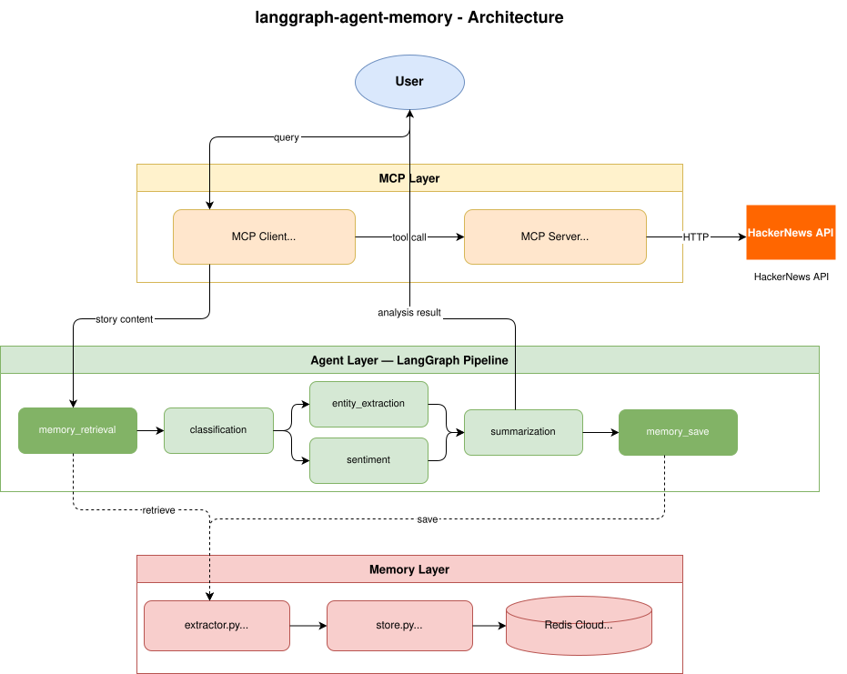

# langgraph-agent-memory

A production-ready AI agent that fetches and analyzes stories from HackerNews — and actually remembers what it did.

Built to demonstrate how to implement **long-term memory** for LangGraph agents using Redis, without relying on high-level SDKs that abstract away the important details.

---

## What This Project Does

Most agents are stateless — every session starts from scratch. This project shows how to build an agent that:

- Fetches live content from HackerNews via an **MCP server**
- Runs a full **text analysis pipeline** (classification → entity extraction → sentiment → summarization)
- **Remembers user preferences and past interactions** across sessions using Redis vector search

---

## Architecture



Three layers work together:

**1. MCP Layer** — connects the agent to the outside world
The MCP server exposes HackerNews as a set of tools (`get_top_stories`, `search_stories`, `get_story_content`). The LLM decides which tool to call based on the user's query.

**2. Agent Layer** — the analysis pipeline
A LangGraph graph with parallel execution:
```
memory_retrieval → classification → [entity_extraction + sentiment] → summarization → memory_save
```

**3. Memory Layer** — long-term memory backed by Redis
Built from scratch on top of Redis vector search. Handles embedding generation, deduplication, semantic retrieval, and LLM-based memory extraction.

---

## How It Works

```
User query
    ↓
MCP Client — LLM decides which HackerNews tool to call
    ↓
MCP Server — fetches data from HackerNews API
    ↓
LangGraph Agent — runs full analysis pipeline
    ↓                         ↑
memory_retrieval          memory_save
(load past context)       (store new memories)
    ↓
Redis — vector search across stored memories
```

---

## Setup

### 1. Clone and install

```bash
git clone https://github.com/your-username/langgraph-agent-memory
cd langgraph-agent-memory
python -m venv .venv
source .venv/bin/activate
pip install -r requirements.txt
```

### 2. Environment variables

Create a `.env` file:

```env
GROQ_API_KEY=your_groq_api_key
REDIS_URL=redis://your-redis-cloud-url:port
```

### 3. Redis

This project uses **Redis Cloud** with the Search module enabled (required for vector search).
Create a free instance at [redis.io/cloud](https://redis.io/cloud).

### 4. Observability (Optional)

To enable LangSmith tracing — add 3 lines to your `.env`:
```env
LANGCHAIN_TRACING_V2=true
LANGCHAIN_API_KEY=your_langsmith_key
LANGCHAIN_PROJECT=langgraph-agent-memory
```

No code changes required. Every node, token count, and latency will appear automatically in your [LangSmith dashboard](https://smith.langchain.com).
---

## Usage

```bash
python mcp_hn/mcp_client.py
```

Example queries:
```
What are the top stories right now?
Search for stories about machine learning
Get the content of story 47214645 and analyze it
```

---

## Memory System

The memory system is built from scratch — no high-level SDKs. Key design decisions:

- **Embedding model**: `all-MiniLM-L6-v2` (384 dims, runs locally, free)
- **Deduplication**: cosine similarity threshold at write time — prevents storing near-identical memories
- **Extraction**: LLM reads the conversation and decides what's worth remembering
- **Chunking**: long conversations are split before extraction to fit model context windows
- **Types**: `episodic` (user preferences) vs `semantic` (general knowledge)

